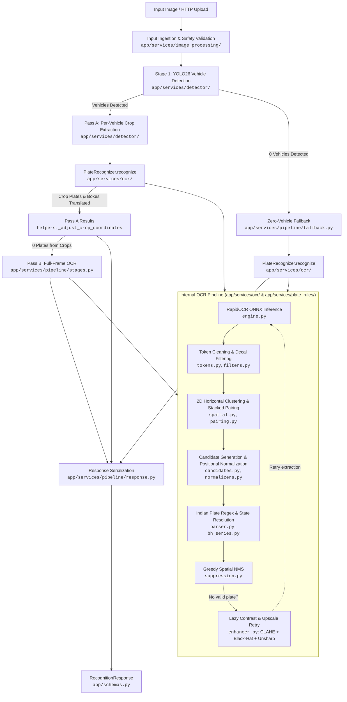

# Argus Architecture Guide

Argus is an Automatic Number Plate Recognition (ANPR) microservice and library designed for automated weighbridge gatekeeping. It couples deep learning vehicle pre-screening with optical character recognition and domain-specific validation.

---

## 1. Pipeline Architecture

Argus executes a two-stage artificial intelligence flow delivering factual detections and OCR results:

---

## 2. Pipeline Execution Stages

1. **Input Ingestion & Safety Validation** ([`app/services/image_processing/`](../app/services/image_processing/)):
   - Verifies payload size and pixel limits against configured bounds (`MAX_UPLOAD_BYTES`, `MAX_IMAGE_PIXELS`).
   - Validates MIME type and image structure via lightweight header probing (`probe_image`) before decoding pixels.
   - Normalizes EXIF orientation and decodes the image at full camera resolution without downscaling (camera is 1080p, preserving character fidelity for weighbridge accuracy).

2. **Stage 1: Vehicle Detection & Proximity Sorting** ([`app/services/detector/`](../app/services/detector/)):
   - Runs Ultralytics YOLO26 inference via ONNX Runtime CPU (`yolo26n.onnx`) to identify `car`, `bus`, `truck`, `motorcycle`, and `bicycle`.
   - Extracts padded bounding box coordinates and crops for all qualified vehicles meeting confidence and area thresholds.
   - Multiple detected vehicles are sorted in proximity order (closest-first, ranked by largest bounding box area).

3. **Stage 2: 5-Tier Cascaded ANPR & Lazy Enhancement** ([`app/services/pipeline/`](../app/services/pipeline/) & [`app/services/ocr/`](../app/services/ocr/)):
   - **Tier 1 (Crop Fast-ALPR, Closest-First)**: Runs Fast-ALPR (YOLOv9-s + CCT-XS) over vehicle crops in closest-first proximity order. Governed by `ENABLE_MULTI_VEHICLE_OCR` (default: `false`): early exits upon the closest vehicle with a valid plate; when set to `true`, scans all detected vehicle crops. Emits recognized plates with `vehicle_box`.
   - **Tier 2 (Full-Frame Fast-ALPR Fallback)**: If crop Fast-ALPR yields no plates, or if zero vehicles were detected (e.g. non-COCO vehicles like tractors or excavators), executes Fast-ALPR directly on the full frame, capturing plates with `vehicle_box=None`.
   - **Tier 3 (Crop RapidOCR Fallback)**: If full-frame Fast-ALPR yields no plates, executes RapidOCR on vehicle crops with lazy CLAHE and morphological black-hat contrast enhancement for dirty or worn plates missed by Fast-ALPR. Emits recognized plates with `vehicle_box`.
   - **Tier 4 (Full-Frame RapidOCR Fallback)**: If crop RapidOCR yields no plates (or if zero vehicles were detected), executes full-frame RapidOCR as the final OCR safety net (`vehicle_box=None`).
   - **Tier 5 (Clean Empty Output & Strict Plate-Only)**: If all tiers fail to detect a plate, returns an empty array `results: []`. Unplated vehicles are omitted entirely (e.g. if $v_1$ has no plate but $v_2$ and $v_3$ do, only $2$ results are emitted).
   - **Lazy Two-Pass Contrast Enhancement**: Initial extraction runs on the raw RGB raster. If and only if no valid plate candidates are recognized, [`enhancer.py`](../app/services/ocr/enhancer.py) executes:
     1. *Bicubic Upscaling*: If $\min(w, h) < 300$, scales up to $2.0\times$ (clamped by $640 / \max(w, h, 1)$).
     2. *CLAHE*: Contrast Limited Adaptive Histogram Equalization (`clipLimit=2.5, tileGridSize=(8, 8)`).
     3. *Morphological Black-Hat*: Rectangular structuring element ($k = \max(5, 0.05 \times \min(w, h) \mid 1)$) subtracted from CLAHE image to pop dark characters.
     4. *Unsharp Masking*: Gaussian blur ($\sigma=1.0$) combined via weighted blend ($1.3 \times \text{enhanced} - 0.3 \times \text{blur}$) to sharpen character edges before retrying OCR.

4. **2D Spatial Clustering, Multi-Line Pairing, & Spatial NMS** ([`app/services/ocr/`](../app/services/ocr/)):
   - Cleans OCR tokens and filters out blacklisted decal words ([`tokens.py`](../app/services/ocr/tokens.py)).
   - Groups horizontally aligned tokens into lines using vertical overlap analysis ([`spatial.py`](../app/services/ocr/spatial.py)).
   - Pairs stacked two-line plates (standard on Indian commercial trucks) using horizontal overlap ($\ge 30\%$) and vertical proximity ([`pairing.py`](../app/services/ocr/pairing.py)).
   - Generates candidates from single tokens, horizontal line merges, adjacent line merges, and stacked pairs ([`candidates.py`](../app/services/ocr/candidates.py)).
   - Ranks candidates by validity rank, plate length, OCR confidence, and vertical position ($y$).
   - Applies greedy Spatial NMS ([`suppression.py`](../app/services/ocr/suppression.py)) suppressing boxes with $\text{IoU} > 0.15$, containment $> 0.60$, or duplicate plate strings.

5. **Domain Validation & Normalization** ([`app/services/plate_rules/`](../app/services/plate_rules/)):
   - Strips fused High Security Registration Plate (HSRP) prefixes (`IND`, `1ND`, `IN0`, `IIND`).
   - Filters high-frequency commercial truck decals (`GOODS CARRIER`, `TATA`, `LEYLAND`, mobile numbers).
   - Applies length-specific positional character substitution rules:
     - 11-char: `SS DD AAA NNNN`
     - 10-char: `SS DD AA NNNN` (with series corrections `G3/GT -> GJ`, `D3/DT -> DJ`, etc.)
     - 9-char / 8-char: Permutations for legacy formats and 1-letter series.
     - Positional OCR confusion disambiguation (`CHAR_TO_DIGIT`: `'O'/'D' -> '0'`, `'I'/'L' -> '1'`, `'E' -> '6'`; `DIGIT_TO_CHAR`: `'0' -> 'O'`, `'1' -> 'I'`, `'8' -> 'B'`).
     - Enforces strict factory weighbridge commercial vehicle rules: only standard State series registrations (`[State] [District] [Series] [4-digit]` and `[State] [District] [4-digit]`) are accepted; non-commercial and legally prohibited weighbridge formats (Bharat Series `BH`, Military `^`, and Diplomatic `CD/CC/UN`) are rejected.
   - Corrects common OCR state prefix errors (`W8 -> WB`, `RT -> RJ`, `D1 -> DL`, `0D -> OD`).
    - Validates state prefix codes against [`app/services/plate_rules/states.py`](../app/services/plate_rules/states.py).

6. **Spatial Association, Bumper Alignment, & Dedup** ([`app/services/pipeline/`](../app/services/pipeline/)):
   - Attributes full-frame OCR plates to detected vehicles via:
     1. *Direct Containment*: Plate box $\ge 50\%$ contained inside vehicle box.
     2. *Bumper Alignment*: Plate box below vehicle top with horizontal overlap $\ge 50\%$ and vertical offset $dy \le 0.80 \times \text{vehicle\_height}$.
     3. *Single-Vehicle Fallback*: If only 1 vehicle exists in frame and plate has no box.
   - Unmatched plates are emitted with `vehicle_type=None`.
   - Deduplicates identical plates across crop and full-frame passes.
   - Unplated vehicles are omitted entirely (only detected and validated plates are emitted in the response).

---

## 3. Component Responsibilities & Modular Structure (NASA JPL Rule 4)

All service domains in `app/` strictly follow **NASA JPL Rule 4** (Holzmann's *Power of 10* coding rules): every single file and function is $\le$ 60 lines, fitting completely on a single printed sheet of standard paper.

| Component | Subpackage Path | Key Modules & Responsibility |
| :--- | :--- | :--- |
| **REST Server** | [`app/server.py`](../app/server.py) | Application factory assembling modular `lifespan`, `middleware`, `errors`, and `api_router`. |
| **API Layer** | [`app/api/`](../app/api/) | `router.py`, `routes/info.py`, `routes/recognition.py`, `dependencies.py`, `errors.py`: Thin route handlers, APIRouters, dependency injection, and centralized JSON error responses. |
| **Core Utilities** | [`app/core/`](../app/core/) | `lifespan.py` (model pre-warming), `middleware.py` (CORS, request logging, and timing headers), `contracts.py` (`require`, `ensure`), `bounds.py` (`bounded`), `config.py`, `constants.py`, `exceptions.py`, `logging.py`. |
| **Pipeline Orchestrator** | [`app/services/pipeline/`](../app/services/pipeline/) | `orchestrator.py`, `stages.py`, `sorting.py`, `fallback.py`, `helpers.py`, `response.py`: Coordinates detection, stage progress logging, proximity sorting, dual-pass OCR, fallbacks, coordinate adjustments, and response packaging. |
| **Vehicle Detector** | [`app/services/detector/`](../app/services/detector/) | `detector.py`, `geometry.py`, `box.py`, `parser.py`, `constants.py`: YOLO26 model singleton, `BoundingBox` rich domain value object, coordinate clamping/containment, and COCO constants. |
| **Image Processing** | [`app/services/image_processing/`](../app/services/image_processing/) | `loader.py`, `security.py`, `transformer.py`, `constants.py`: Polymorphic image decoding, EXIF orientation, decompression bomb defense, and permitted MIME/format constants. |
| **Plate Recognizer** | [`app/services/ocr/`](../app/services/ocr/) | `protocol.py`, `strategies/` (`fast_alpr.py`, `rapidocr.py`), `recognizer.py`, `engine.py`, `enhancer.py`, `extractor.py`, `geometry.py`, `pairing.py`, `spatial.py`, `tokens.py`, `candidates.py`, `suppression.py`: `OCREngine` Strategy Protocol and polymorphic engines (Fast-ALPR and RapidOCR), RapidOCR ONNX inference, CLAHE/Black-Hat enhancement, 2D token pairing, Spatial NMS, and candidate selection. |
| **Plate Rules** | [`app/services/plate_rules/`](../app/services/plate_rules/) | `specs/` (`protocol.py`, `decal.py`, `state_prefix.py`, `format.py`, `composite.py`), `states.py`, `char_maps.py`, `corrections.py`, `decals.py`, `parser.py`, `resolver.py`, `normalizers.py`, `expander.py`, `filters.py`, `bh_series.py`: Specification Pattern (`PlateSpec`, `NonDecalSpec`, `StatePrefixSpec`, `IndianPlateFormatSpec`, `CompositePlateSpec`), Indian registration plate validation, positional OCR character substitution, decal filtering, and BH-series parsing. |
| **Data Models** | [`app/schemas.py`](../app/schemas.py) | Pydantic V2 schemas ([`RecognitionResponse`](../app/schemas.py), [`PlateResult`](../app/schemas.py), [`APIErrorResponse`](../app/schemas.py)) and slotted internal dataclasses ([`OCRToken`](../app/schemas.py), [`PlateCandidate`](../app/schemas.py), [`DetectedVehicle`](../app/schemas.py), [`DetectionResult`](../app/schemas.py)). |

---

## 4. Coordinate Translation & Data Contracts

- **Crop to Frame Mapping**: OCR is executed within the vehicle bounding box crop for speed and precision. Detected plate coordinates $[x_{1,\text{crop}}, y_{1,\text{crop}}, x_{2,\text{crop}}, y_{2,\text{crop}}]$ are automatically translated back to global image frame coordinates:
  $$\text{box}_{\text{global}} = [x_{1,\text{crop}} + cx_1, \; y_{1,\text{crop}} + cy_1, \; x_{2,\text{crop}} + cx_1, \; y_{2,\text{crop}} + cy_1]$$
  where $(cx_1, cy_1)$ is the top-left offset of the vehicle's padded crop box (`crop_box`).
- **Typed Response**: Output is serialized through [`RecognitionResponse`](../app/schemas.py), containing total roundtrip latency (`execution_time_ms`) and a list of thin [`PlateResult`](../app/schemas.py) items containing strictly validated plate registration numbers (`plate`) and per-item latency (`execution_time_ms`).

---

## 5. Concurrency & Performance Model

- **Threadpool Offloading**: YOLO and RapidOCR perform synchronous CPU/GPU inference. FastAPI handlers execute inference via `asyncer.asyncify` offloaded to a worker thread to avoid blocking the asyncio event loop.
- **Concurrency Throttling**: Inferences are bounded by an `asyncio.Semaphore(MAX_CONCURRENT_INFERENCES)` to prevent out-of-memory errors on constrained hardware.
- **Zero-Copy In-Memory Flow**: Ingestion, dimension bounding, cropping, and inference occur entirely in RAM via direct `PIL.Image.Image` references without intermediate compression/decompression or flash/SD card wear.
- **ONNX Runtime Thread Binding**: Intra-op thread count is explicitly configured (`ONNX_NUM_THREADS=4`) to fully engage multi-core ARM Cortex-A76 execution.
- **Python 3.14 Free-Threading**: Under free-threaded CPython (`python3.14t`), GIL serialization is removed, allowing parallel spatial clustering, token pairing, and regex validation across hardware threads.
- For deep deployment instructions, refer to the **[Raspberry Pi 5 Optimization Guide](RASPBERRY_PI_5_OPTIMIZATION.md)**.
