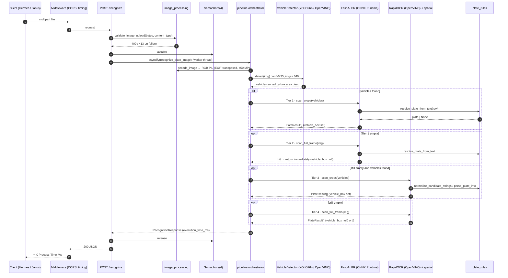

# Argus ANPR — Interface Specification & Integration Contract

| | |
|---|---|
| Service | Argus ANPR Microservice (`pyproject.toml` `name = "argus"`, `version = "0.1.0"`) |
| Source of truth | `app/` — derived from code at `main` `1b4e1b9`, 2026-11-21 |
| Consumers | Hermes (runs on the same Pi host; default deploy target `gluvok@hermes.local`), Janus |
| Transport | HTTP/1.1 REST, JSON responses, `multipart/form-data` request |
| Bind | `127.0.0.1:8000` — loopback only, consumers must be on the same host |
| Auth | None. Isolation relies entirely on the loopback bind. |

---

## 1. Endpoints

### 1.1 `POST /recognize`

Source: `app/api/routes/recognition.py`.

**Request** — `multipart/form-data`, exactly one required field:

| Field | Type | Constraint |
|---|---|---|
| `file` | file part | bytes ≤ `MAX_UPLOAD_BYTES` = 8 MiB (8 × 1024 × 1024); decoded pixels ≤ `MAX_IMAGE_PIXELS` = 50 000 000; format sniffed by Pillow ∈ {`JPEG`, `PNG`, `WEBP`, `BMP`} |

Part `Content-Type` (parameters after `;` ignored) must be one of `image/jpeg`, `image/jpg`, `image/pjpeg`, `image/png`, `image/x-png`, `image/webp`, `image/bmp`, `image/x-ms-bmp`, **or** `application/octet-stream` (accepted so raw-byte clients work). Missing content type is also accepted. The authoritative check is the byte sniff, not the header.

Not supported (despite being common ANPR inputs): base64/JSON bodies, URLs, RTSP/camera stream parameters, multiple files per request, query parameters. A caller holding a camera frame must encode it (e.g. JPEG) and upload it as `file`.

EXIF orientation is applied before inference. The filename is only used for logging.

**Response `200 OK`** — `RecognitionResponse` (`app/schemas.py`):

```json
{
  "results": [
    { "plate": "RJ09GA0165", "vehicle_box": [10, 10, 50, 50], "execution_time_ms": 31.42 }
  ],
  "execution_time_ms": 31.42
}
```

| Field | Type | Semantics |
|---|---|---|
| `results` | `PlateResult[]` | Validated, de-duplicated plates. **Empty list = no plate found; still `200`.** |
| `results[].plate` | `string` | Normalised Indian registration: uppercase `[A-Z0-9]`, no spaces/dashes, HSRP `IND` prefix stripped. Matches `INDIAN_PLATE_REGEX` (§3.4) with a known state code. |
| `results[].vehicle_box` | `[x1, y1, x2, y2]` int, or `null` | Vehicle bounding box in original-image pixel coords (post-EXIF-rotation). `null` when the plate came from a full-frame tier (2 or 4). |
| `results[].execution_time_ms` | `float` | Currently always equal to the top-level value (overwritten in `pipeline/response.py`). Not a per-plate timing. |
| `execution_time_ms` | `float` | Wall time of `recognize_plate_image` (decode + cascade), 2 dp. Excludes upload read, validation, and semaphore queueing. |

Not in the response: per-plate confidence, plate bounding box, state name, which tier matched, raw OCR text. RapidOCR computes `state`/`confidence`/`box`/`raw_text` internally but `PlateResult` drops them. A consumer needing them requires a schema change in Argus.

**Ordering.** Tier 1/3: vehicle order (largest box area first), then engine-candidate order within a vehicle. Tier 2: Fast-ALPR candidates by mean character confidence desc. Tier 4: RapidOCR candidate rank (§3.3). With the default `ENABLE_MULTI_VEHICLE_OCR=false`, crop tiers return plates from **only the first vehicle that yields one** — for a weighbridge with one vehicle, `results[0]` is the answer.

**Response header** on every response: `X-Process-Time-Ms: <float>` — full middleware round-trip including queueing.

### 1.2 `GET /health`

Static. `{"status": "healthy", "service": "Argus ANPR Microservice", "version": "dev"}` (see §1.3 for why `version` is `"dev"`). **Does not check that models loaded** — warm-up failures at startup are logged as warnings and the service still reports healthy. Liveness only; use one `POST /recognize` on a known image as a readiness probe.

### 1.3 `GET /`

`{"name": "Argus ANPR Microservice", "version": "dev", "status": "running", "docs": "/docs"}`. `version` comes from installed package metadata (`importlib.metadata.version("argus")`), falling back to `"dev"`. Because `pyproject.toml` has no `[build-system]`, `uv sync` does not install `argus` as a distribution, so in practice (dev and Pi) the value is `"dev"`, not the `0.1.0` in `pyproject.toml` / README. Don't use it for compatibility checks.

### 1.4 Docs

OpenAPI UI `/docs`, ReDoc `/redoc`, schema `/openapi.json` (FastAPI default).

### 1.5 CORS

`allow_origins=["*"]`, all methods/headers, `allow_credentials=False`. Only relevant to browser callers on the same host.

---

## 2. Error contract

Source: `app/api/errors.py`, `app/core/exceptions.py`. Every Argus-handled error returns `APIErrorResponse`:

```json
{
  "success": false,
  "status_code": 413,
  "message": "Image exceeds maximum permitted size of 8 MB.",
  "error_type": "PayloadTooLargeError",
  "details": null,
  "timestamp": "2026-11-21T10:00:00.000000Z"
}
```

| HTTP | `error_type` | Raised when | Retry? |
|---|---|---|---|
| 400 | `InvalidImageError` | disallowed `Content-Type`; empty body; Pillow format not JPEG/PNG/WEBP/BMP; bytes not decodable | No — fix input |
| 413 | `PayloadTooLargeError` | bytes > 8 MiB; width × height > 50 MP; Pillow `DecompressionBombError` | No — downscale/re-encode |
| 422 | `RequestValidationError` | `file` part missing / malformed multipart; `details` = FastAPI `exc.errors()` list | No |
| 500 | `ContractViolation` | internal `require`/`ensure` invariant failed; `details` = violation message string | Maybe once |
| 500 | `InternalServerError` | any other unhandled exception — notably **a Fast-ALPR failure in tier 1 or 2** (those tiers have no try/except, so the cascade aborts instead of falling back to RapidOCR) | Yes, with backoff |
| 500 | `ANPRServiceError` | base domain error (not raised directly today) | Yes |
| 404 / 405 | — | unknown route / wrong method: Starlette default body `{"detail": "..."}`, **not** `APIErrorResponse` | No |

Validation order for `/recognize`: content-type → empty → byte size → format sniff (all before the semaphore) → pixel budget → full decode (inside the worker). So an oversized wrong-type upload gets 400, not 413.

The whole body is read into memory before the 8 MiB check; there is no streaming cap at the HTTP layer.

---

## 3. ANPR pipeline

### 3.1 Sequence



### 3.2 Stage 1 — vehicle detection (`app/services/detector/`)

- Model: `YOLO("yolo26n_openvino_model")`, resolved **relative to the process CWD** (`/opt/argus` in production). COCO export, `imgsz=640`, `agnostic_nms=True`.
- Classes kept: `1 bicycle`, `2 car`, `3 motorcycle`, `5 bus`, `7 truck`. Anything else (tractors, carts) yields zero vehicles, which is why full-frame tiers exist.
- Filters: `conf ≥ VEHICLE_CONF_THRESH (0.35)`; box area ≥ `MIN_VEHICLE_BOX_AREA_RATIO (0.01)` of the frame; both edges ≥ `MIN_CROP_EDGE_PX (8)` after clamping; at most `MAX_DETECTIONS (100)` raw detections considered.
- Dedup: greedy by confidence, drop if IoU > `VEHICLE_IOU_THRESH (0.50)` or either box ≥70% contains the other. Output sorted by area desc ("closest first").
- Each vehicle carries a PIL crop of its box. Inference is serialised by a class-level `threading.Lock`.

### 3.3 Stage 2 — plate engines

| Tier | Engine | Input | Specifics | README latency* |
|---|---|---|---|---|
| 1 | Fast-ALPR | each vehicle crop | plate detector `yolo-v9-s-608-license-plate-end2end` (conf 0.25) → each plate box padded by max(10 px, 15%) horizontally / max(5 px, 10%) vertically → OCR `cct-xs-v2-global-model` → candidates sorted by mean char confidence → first that passes `resolve_plate_from_text` | ~30–50 ms |
| 2 | Fast-ALPR | full frame (BGR) | same as tier 1; `vehicle_box=null`; on hit the cascade returns immediately | ~30–50 ms |
| 3 | RapidOCR | each vehicle crop | see below; plate box translated crop→frame internally | ~120–180 ms |
| 4 | RapidOCR | full frame | same; `vehicle_box=null`; final tier, may return `[]` | ~220–280 ms |

\* Figures from `README.md`, not re-measured for this spec. Measure with `uv run python test_direct.py` (writes `benchmark_report.md`). Tiers are cumulative: a frame that falls through to tier 4 costs roughly the sum of all tiers plus detection.

Fast-ALPR ONNX providers: everything `onnxruntime.get_available_providers()` reports except `CoreMLExecutionProvider`. **No confidence floor** is applied to Fast-ALPR output — plate validity is the only gate.

**RapidOCR flow** (`app/services/ocr/extractor.py`, `spatial/`), Det/Cls/Rec all on OpenVINO with `inference_num_threads=4`, under one global lock:
1. Drop tokens with score < 0.20; strip to `[A-Z0-9]`; drop chunks < 2 chars, decal words, phone numbers.
2. Cluster into lines: vertical box overlap ≥ 0.4 of the shorter box (or |Δcy| ≤ 8 px without boxes).
3. Candidate strings from: each token; each multi-token line; each adjacent line pair (two-row plates); spatial pairs among the next 5 tokens with centroid distance ≤ 150 px and |Δcx| ≤ 90 px.
4. Each string is expanded (§3.4); a permutation that full-matches the regex and passes `parse_plate_info` becomes a candidate with confidence = mean token score.
5. Rank by `(round(conf, 2), len(plate), -rank, y_pos)` desc, then greedy NMS: drop if same plate, IoU > 0.15, or ≥60% containment.
6. If nothing valid: one retry on a contrast-enhanced image — upscale ≤2× if short side < 300 px, CLAHE (clip 2.5, 8×8), black-hat subtraction, unsharp mask.

Engine errors in tiers 3/4 are logged and become `[]` (fall-through). Errors in tiers 1/2 propagate as 500 (§2).

### 3.4 Plate validation (`app/services/plate_rules/`)

- **Regex** (`states.py`): `STATE (0[1-9]|[1-9]\d|[1-9]) SERIES{1-3 letters, no I/O} NNNN` or the older `STATE DD NNNN`; optional `space . -` separators (output never contains them).
- **State codes:** 41 entries, including legacy aliases (`OR`→Odisha, `UA`→Uttarakhand), both Telangana codes (`TS`, `TG`), and `BP` (Police / Government Series).
- **Expansion** (`expander.py`, `normalizers.py`): strip HSRP prefixes `IND`, `1ND`, `IN0`, `IIND`; try dropping 1–2 leading noise chars; collapse over-long series; apply 39 two-char state-prefix OCR fixes (e.g. `W8`→`WB`, `R3`→`RJ`, `0D`→`OD`); then length-specific (8/9/10/11 char) positional maps — letters→digits in district/number slots (`O/D/Q→0`, `I/L/H→1`, `Z→2`, `A→4`, `S→5`, `E/G→6`, `T→7`, `B→8`), digits→letters in the series slot, series `I→J`, `O→D` (MoRTH-prohibited letters), `G3→GJ`, `D3→DJ`.
- **Rejects:** word blacklist (`TATA`, `GOODS`, `FASTAG`, `NATIONAL`, `PERMIT`…), substrings (`CARRIER`, `LEYLAND`, `TRANSPORT`, `NATIONALPERMIT`, `FASTAG`, `DIESEL`), and 10-digit Indian mobile numbers (optional `MOB/PH/TEL/CALL/CONTACT` prefix).
- **Spec composition:** `STANDARD_PLATE_SPEC = StatePrefixSpec ∧ IndianPlateFormatSpec`; Fast-ALPR text is additionally gated by `NonDecalSpec`.

Not supported: BH-series (`22BH1234AA`), temporary/trade, diplomatic, and non-Indian formats — they are silently filtered and yield `200 []`.

### 3.5 State per request

`received → validated (or 400/413) → queued on semaphore → decoding (or 400/413) → detected(n vehicles) → T1 → [T2] → [T3] → [T4] → responded`, where each bracketed tier runs only if every earlier tier yielded nothing. There is no request-to-request state: no DB, no result cache, no cross-frame tracking. The same image always takes the same path.

---

## 4. Concurrency & capacity

- `MAX_CONCURRENT_INFERENCES = 4`: one process-wide `asyncio.Semaphore`. Excess requests wait (no 429, no Argus-side timeout). Consumers should set their own client timeout and avoid deep queues; one in-flight request per camera trigger is the intended pattern.
- Work runs in AnyIO worker threads (`asyncer.asyncify`). YOLO and RapidOCR are each serialised by a lock, so parallel requests mainly overlap on decode and Fast-ALPR.
- Single uvicorn worker (`fastapi run`, no `--workers`). Models are lazy singletons, warmed at startup with blank frames (640×640 YOLO, 128×64 OCR engines).

---

## 5. Configuration

| Name | Source | Default | Effect |
|---|---|---|---|
| `ENABLE_MULTI_VEHICLE_OCR` | env or `.env` in CWD (`pydantic-settings`, `extra="ignore"`) | `false` | `true` → crop tiers scan every vehicle and return all distinct plates instead of stopping at the first vehicle with a hit |
| `YOLO_CONFIG_DIR` | set by `app/core/constants.py` at import | `<CWD>/.cache/ultralytics` | isolates Ultralytics settings |
| `CI` | `setdefault` in constants | `true` | suppresses Ultralytics interactive/telemetry behaviour |

Everything else (thresholds, limits, host, port) is a code constant in `app/core/constants.py` and requires a redeploy. `deploy.py` excludes `.env*` from rsync, so a Pi `.env` must be created on-device at `/opt/argus/.env`.

---

## 6. Edge deployment (Raspberry Pi 5)

`uv run python scripts/deploy.py --host gluvok@hermes.local` (default host; `--dry-run` prints commands). The systemd `User=` is the part of `--host` before `@`, else `$USER`. Stages (`scripts/deploy_commands.py`):

1. **Prep** (`ssh -t`): create and chown `/opt/argus`; install `ccache` via apt if missing; install `uv` if missing.
2. **Sync**: `rsync -avz --delete` repo root → `/opt/argus/`, excluding `.venv`, `.env*`, `__pycache__`, `.git`, `tests`, `docs`, `debug_crops`, `debug_output`, `.cache`, `.coverage`, `.pytest_cache`, `.ruff_cache`, `compiled_dist`, `dist`. This ships `yolo26n_openvino_model/` (`yolo26n.xml`, `yolo26n.bin`, `metadata.yaml`), `yolo26n.onnx`, `pyproject.toml`, `uv.lock`.
3. **Compile**: `uv sync` (on the Pi, dev group included, so Nuitka is present), then
   `uv run python -m nuitka --module --include-package=app --nofollow-imports --remove-output --lto=yes --python-flag=no_docstrings --output-dir=/opt/argus/dist app`.
   The whole `app` package becomes one native CPython extension (`app.cpython-*.so`); third-party packages stay as normal wheels in `.venv` (`--nofollow-imports`). The step moves `app*so` to `/opt/argus/`, writes `run.sh` (`exec /opt/argus/.venv/bin/fastapi run --host 127.0.0.1 --port 8000`), then **deletes** `app/`, `dist/`, `tests/`, `docs/`, `debug_crops/`, `scripts/` and every top-level `*.py`. `fastapi run` finds `app.server:app` via `[tool.fastapi]` in the retained `pyproject.toml`; `import app` resolves to the `.so`.
4. **Service**: render `dist/argus.service` locally → `scp` to `/tmp` → move to `/etc/systemd/system/argus.service` → `daemon-reload`, `enable --now`, `restart`.

Unit (`generate_systemd_unit`): `Type=simple`, `WorkingDirectory=/opt/argus`, `ExecStart=/opt/argus/run.sh`, `Restart=always`, `RestartSec=5`, `Environment=PYTHONUNBUFFERED=1`, `After=network.target`, `WantedBy=multi-user.target`. Loopback-only binding is guarded by tests in `tests/test_deploy.py` added in PR #28 (pending merge).

**Model weights not in the repo:** Fast-ALPR downloads its plate detector and OCR model on first initialisation into `~/.cache/open-image-models/` and `~/.cache/fast-plate-ocr/` of the service user. The Pi needs internet on first start, or those directories must be pre-seeded. If the download fails, warm-up logs a warning, `/health` stays `healthy`, and the first `/recognize` that reaches tier 1 returns 500.

**CI release path** (`.github/workflows/nuitka.yml`): after `CI` succeeds on `main` (or on a `v*` tag / manual run), the same Nuitka command runs on `ubuntu-26.04-arm` and an orphan `release` branch is force-pushed with `app.*.so`, `pyproject.toml`, `uv.lock`, `README.md`, `.python-version`, `yolo26n_openvino_model/`, `yolo26n.onnx`, and `scripts/`. `deploy.py` does not consume this branch — it compiles on-device.

Operations (standard systemd, not wrapped by Argus): `systemctl status argus`, `journalctl -u argus -f`. Log lines are loguru: `Incoming request …`, `[pipeline] Tier N …`, `Completed request … (x ms)`.

---

## 7. Integration checklist for Hermes / Janus

1. Call `http://127.0.0.1:8000/recognize` from the same host; Argus is unreachable off-box by design.
2. Send one JPEG < 8 MiB as multipart field `file` with `Content-Type: image/jpeg` (or `application/octet-stream`).
3. Treat `200` + `results: []` as "no plate read" — a business outcome, not a failure. Use `results[0].plate` as the primary read.
4. Retry only on 5xx (and connection errors while systemd restarts the unit, ~5 s). Never retry 400/413/422.
5. Branch on `error_type`, not on `message` text.
6. Don't rely on `/health` for model readiness.
7. Any change to `PlateResult` / `RecognitionResponse` in `app/schemas.py` is a breaking contract change — update this spec and both consumers together.
